<div align="center">

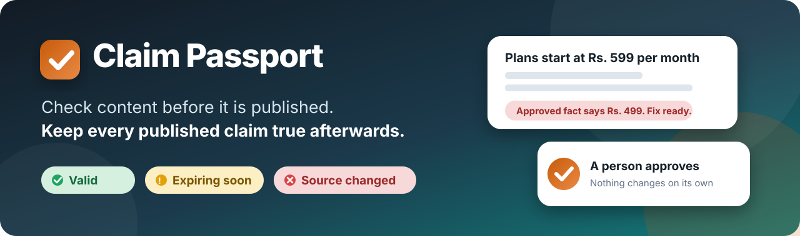

<br>

[](#-quick-start)
[](#-architecture)
[](#-architecture)
[](#-by-the-numbers)
[](LICENSE)
[](#-honest-limits)

**[🚀 Quick start](#-quick-start)** ·
**[📸 Screenshots](#-see-it-in-action)** ·
**[✨ Features](#-features)** ·
**[🔄 How it works](#-how-it-works)** ·
**[👥 Roles](#-who-can-do-what)** ·
**[🏗 Architecture](#-architecture)** ·
**[🔌 API](#-api-in-30-seconds)** ·
**[⚠️ Limits](#-honest-limits)** ·
**[🗺 Roadmap](#-roadmap)**

</div>

---

## 💡 The idea in one minute

Companies publish content through many writers, agencies and AI tools. Wrong facts, old prices and claims nobody can prove slip through, and **a claim that was true on publishing day can become false later** ("Plans start at Rs. 499", "10,000+ customers", "ISO certified").

**Claim Passport** checks content *before* it goes live, explains every problem with its source, and suggests fixes that keep the writer's meaning. After publishing, every verified claim carries a **passport** (source, owner, expiry, live status). When a source changes, the platform finds every page that is now wrong and prepares a fix. **A person always decides.**

| | 😬 Without it | ✅ With Claim Passport |
|---|---|---|
| **Before publishing** | Manual review, inconsistent feedback | Instant checks with a reason, a source and a fix for every issue |
| **Wrong numbers** | Found by customers | Compared with the approved fact, fixed in one click |
| **After publishing** | Nobody re-checks old pages | Source change → affected pages flagged → fix ready |
| **AI use** | Hidden | Every AI or outside service call is logged and disclosed |
| **Accountability** | "Who approved this?" | Full audit trail and a Proof Time Machine |

<div align="center">
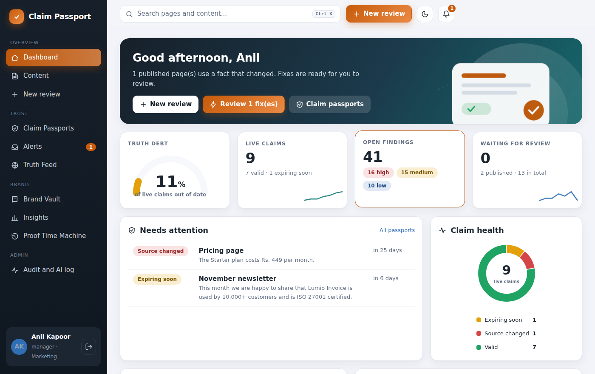
<br><sub>The dashboard: Truth Debt gauge, claim health, content pipeline, and what will go stale next.</sub>
</div>

---

## 📸 See it in action

<table>
<tr>
<td width="50%">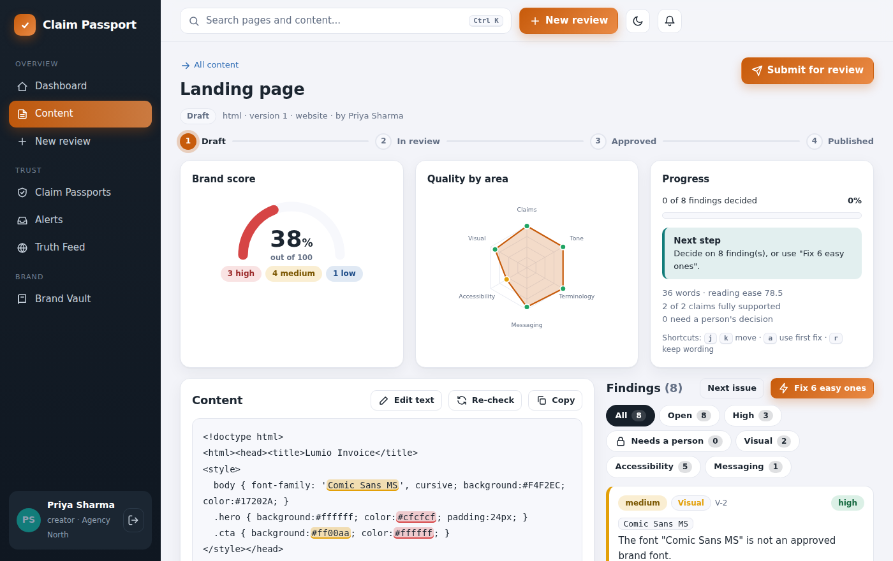<br><b>🧑‍💻 Review workspace</b><br><sub>Brand score, quality radar, progress, step tracker and highlighted text.</sub></td>
<td width="50%">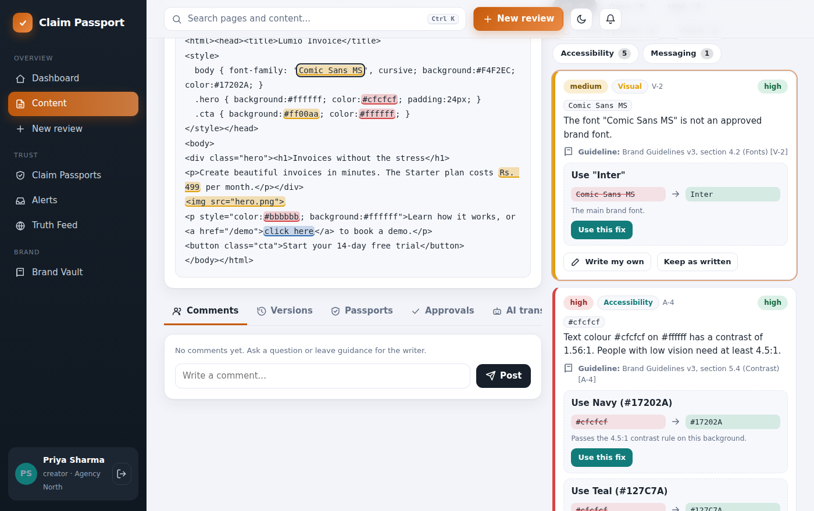<br><b>🔎 Explained findings</b><br><sub>Each issue shows its rule or fact, a confidence level and a before/after preview.</sub></td>
</tr>
<tr>
<td>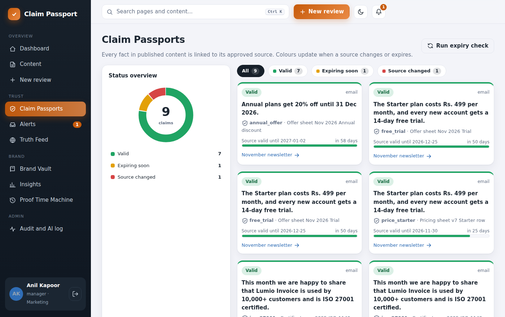<br><b>🛂 Claim Passports</b><br><sub>Every published claim linked to its source, with an expiry bar.</sub></td>
<td>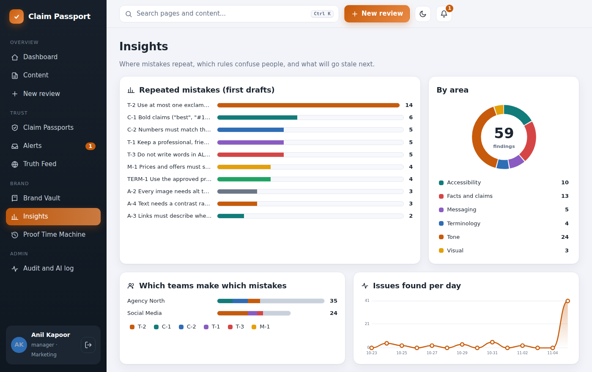<br><b>📊 Insights</b><br><sub>Repeated mistakes, team patterns and guidelines that may be unclear.</sub></td>
</tr>
<tr>
<td>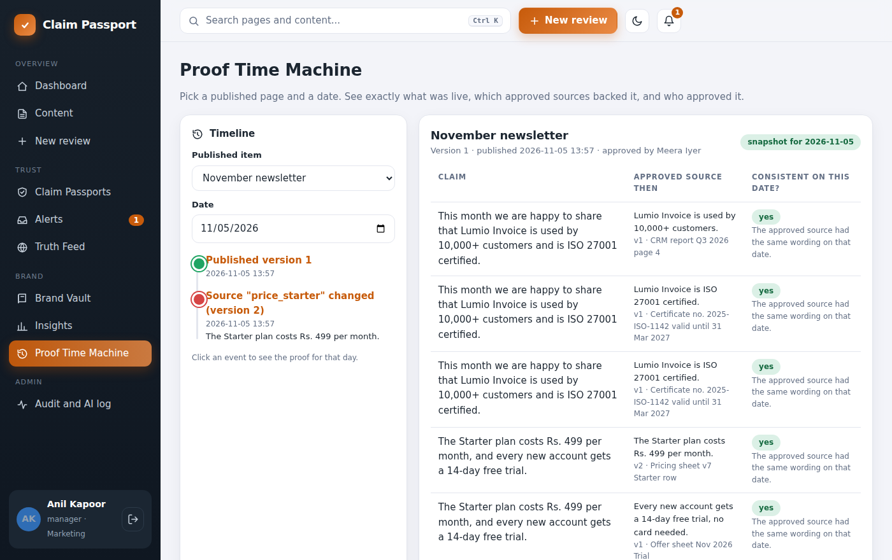<br><b>⏳ Proof Time Machine</b><br><sub>Pick a page and a date: what was live, which source backed it, who approved it.</sub></td>
<td>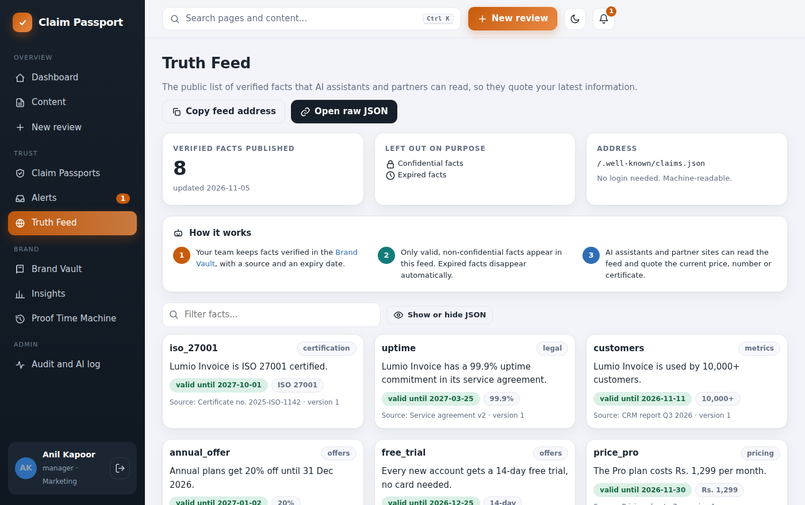<br><b>🌐 Truth Feed</b><br><sub>Verified facts that AI assistants can read, so they quote current information.</sub></td>
</tr>
</table>

<details>
<summary><b>🎨 More screens: new review, Brand Vault, login, dark mode, mobile</b></summary>
<br>
<table>
<tr>
<td width="50%">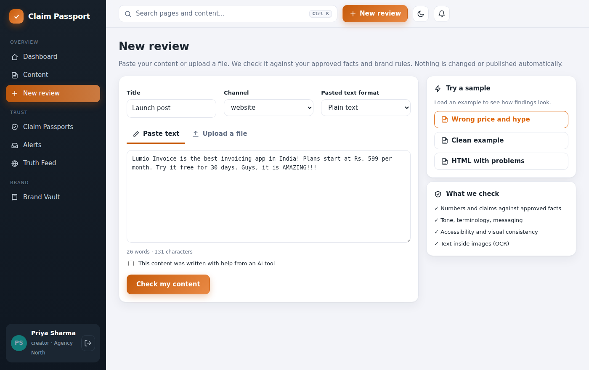<br><sub><b>New review</b>: paste or drag and drop a file, or try a sample.</sub></td>
<td width="50%">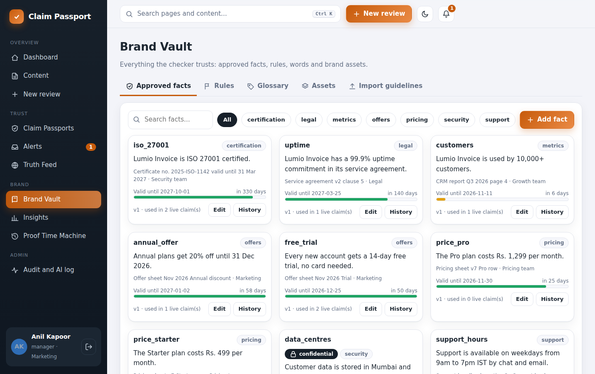<br><sub><b>Brand Vault</b>: searchable fact cards with expiry bars.</sub></td>
</tr>
<tr>
<td>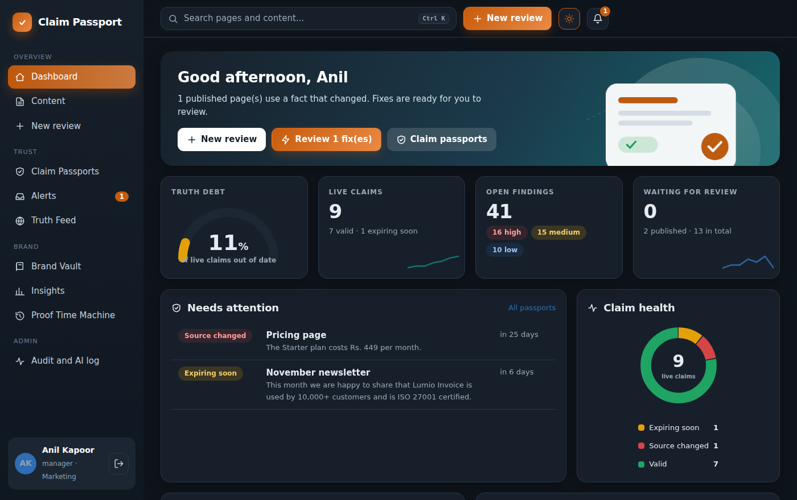<br><sub><b>Dark mode</b> (one click in the top bar).</sub></td>
<td>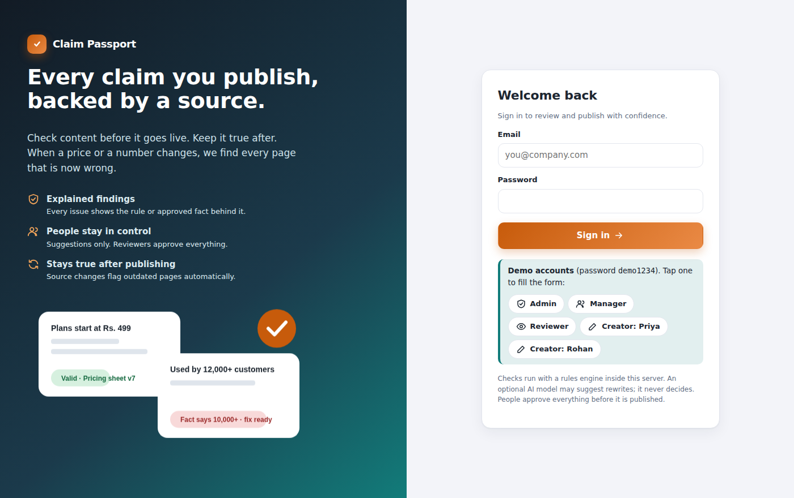<br><sub><b>Login</b> with one-tap demo accounts.</sub></td>
</tr>
</table>
<p align="center">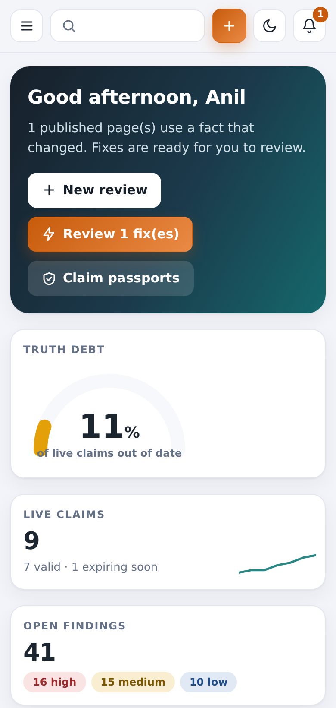<br><sub>Works on a phone too.</sub></p>
</details>

---

## ✨ Features

| | Feature | What it does |
|---|---|---|
| 📚 | **Brand Vault** | Approved facts (source, owner, expiry, version history), rules imported from a markdown guideline file, glossary, brand assets |
| 📄 | **Many file types** | Text, Markdown, HTML, PDF, Word, PowerPoint, PNG/JPG/WebP (OCR reads text inside images) |
| 🔎 | **Claim finder** | Spots numbers, prices, superlatives ("best"), absolutes ("100%", "24x7"), certificates and comparisons |
| ✅ | **Fact checker** | Matches each claim to an approved fact, compares numbers by value and kind, understands "over 5,000" vs "10,000+" |
| 🧪 | **19 built-in checks** | Tone, terminology, messaging, accessibility (WCAG contrast, alt text, links, reading ease), visual (colours, fonts, image size/shape) |
| 💬 | **Explain + suggest** | Plain reason, exact guideline or fact (with page), confidence, and a fix that changes only the problem phrase |
| 👤 | **Human control** | Nothing applies until a person accepts. Locked claims (price, legal, certificates, comparisons) need a reviewer |
| 🔁 | **Review workflow** | Draft → In review → Approved → Published, with versions, word-level diff, comments, approvals, audit trail |
| 🛂 | **Claim Passports** | Live status per claim: 🟢 valid · 🟡 expiring · 🔴 source changed · 🔴 expired · 🟣 no source |
| 🐕 | **Source-change watcher** | "Dependabot for claims": change a fact and every affected page is flagged with a ready fix |
| 📉 | **Truth Debt + half-life** | One score for how much live content is out of date, and a forecast of what goes stale next |
| 🌐 | **Truth Feed** | Public `/.well-known/claims.json` of verified, non-confidential, non-expired facts for AI tools |
| ⏳ | **Proof Time Machine** | See what was live on any date, which sources backed it, and who approved it |
| 📊 | **Insights** | Repeated mistakes by rule and team, and an "unclear guideline" detector with evidence |
| 🔒 | **Privacy** | Roles, confidential facts, personal-data masking, and an AI Transparency log |
| ⌨️ | **Friendly UI** | `Ctrl+K` command palette, `j` `k` `a` `r` shortcuts, "Fix easy ones" in one click, light/dark, mobile |

<details>
<summary><b>📋 Coverage of the Inkloom AI problem statement</b></summary>

| Requirement | Status | Where |
|---|:---:|---|
| Import or define guidelines, approved facts, terminology, assets | ✅ | `vault.py` |
| Review text, images, documents | ✅ | `ingest.py` |
| Detect tone, language, facts, claims, visuals, accessibility | ✅ | `engine/` |
| Explain issues and name the guideline or source | ✅ | `engine/pipeline.py` |
| Suggest corrections without overriding humans | ✅ | `engine/suggest.py`, `workflow.py` |
| Comments, approvals, revision history, roles | ✅ | `workflow.py`, `security.py` |
| Recurring problems and unclear guidelines | ✅ | `insights.py` |
| Protect confidential material, disclose AI use | ✅ | `security.py`, `engine/llm.py`, `audit.py` |
| Balance automation and human control | ✅ | `engine/pipeline.py`, `workflow.py` |
| Reliable, explainable results | ✅ | deterministic engine + 67 tests |

</details>

---

## 🔄 How it works

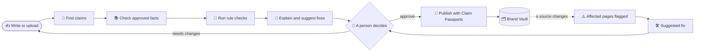

<div align="center">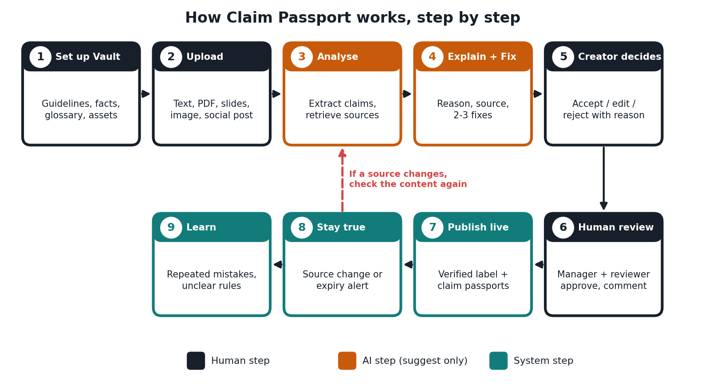</div>

### 🐕 When a source changes

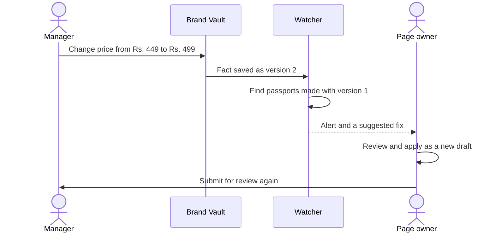

<div align="center">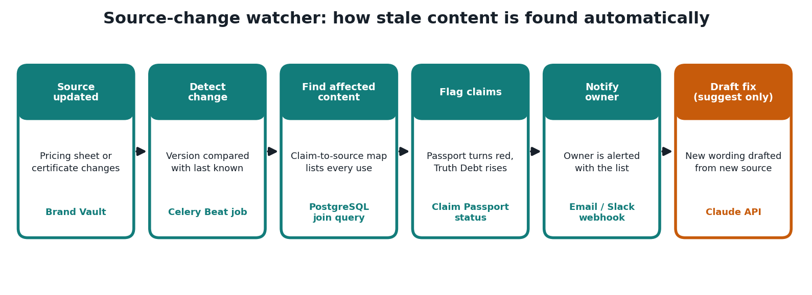</div>

### 🚦 Passport status

| Status | Meaning |
|---|---|
| 🟢 **Valid** | Source unchanged and not close to expiry |
| 🟡 **Expiring soon** | Source expires within 14 days (`CP_EXPIRY_WARN_DAYS`) |
| 🔴 **Source changed** | The fact's wording or value changed after publishing |
| 🔴 **Source expired** | The expiry date has passed |
| 🟣 **No source** | A person approved the claim without a verified source |

> **Truth Debt** = (source changed + expired + removed + no source) ÷ all live claims.

---

## 🚀 Quick start

> **You need:** Python 3.10+ (tested on 3.12). Optional: the `tesseract` program to read text inside images.

```bash
pip install -r requirements.txt
python run.py
```

Open **http://127.0.0.1:5000**. The first start loads a demo brand (*Lumio Invoice*), demo users and sample content.

### 🔑 Demo accounts  <sub>(password `demo1234`, change or disable before real use)</sub>

| Role | Email | Try this |
|---|---|---|
| 👑 Admin | `admin@demo.cp` | Everything, including users and audit |
| 🧭 Manager | `anil@demo.cp` | Edit the Vault, publish, watch Truth Debt and insights |
| 🕵️ Reviewer | `meera@demo.cp` | Approve content, including locked claims |
| ✍️ Creator | `priya@demo.cp` · `rohan@demo.cp` · `kabir@demo.cp` | Write content and decide on findings |

### 🧭 5-minute tour

1. **Priya** → *Content → Landing page*: read the findings, press **Fix easy ones**, or `j` / `a` with the keyboard.
2. **Anil** → *Dashboard*: the **Pricing page** shows *Source changed* and a fix waits under **Alerts**.
3. **Anil** → *Brand Vault*: edit a price and watch Truth Debt and Alerts update (or run `python scripts/demo_source_change.py`).
4. **Anil** → *Insights*: see which guideline is probably unclear.
5. **Anil** → *Proof Time Machine*: click an event on the timeline.

Full script: **[docs/DEMO_SCRIPT.md](docs/DEMO_SCRIPT.md)**.

<details>
<summary><b>🏢 Real install (no demo data)</b></summary>

```bash
CP_SEED_DEMO=0 \
CP_ADMIN_EMAIL=you@company.com \
CP_ADMIN_PASSWORD='a-long-password' \
CP_SECRET_KEY='a-long-random-string' \
python run.py
```
</details>

<details>
<summary><b>🐳 Docker</b></summary>

```bash
docker compose up --build      # http://localhost:8000
```
The Docker and CI files are written but were not executed in the build environment. Please test them on your machine.
</details>

<details>
<summary><b>🧪 Run the tests</b></summary>

```bash
python -m unittest discover -s tests -t . -v     # 67 unit and API tests
python tests/ui_smoke.py                         # optional: full journey in a real browser (needs playwright)
```
</details>

---

## 👥 Who can do what

| Action | ✍️ Creator | 🕵️ Reviewer | 🧭 Manager | 👑 Admin |
|---|:---:|:---:|:---:|:---:|
| See all content (creators see only their own) | ❌ | ✅ | ✅ | ✅ |
| Create content, accept or edit a suggestion | ✅ | ✅ | ✅ | ✅ |
| Keep a locked or high-risk wording as written | ❌ | ✅ | ✅ | ✅ |
| Approve content (never your own) | ❌ | ✅ | ✅ | ✅ |
| Approve content with locked claims | ❌ | ✅ | ❌ | ✅ |
| Publish | ❌ | ❌ | ✅ | ✅ |
| Edit the Brand Vault, run the watcher | ❌ | ❌ | ✅ | ✅ |
| See insights | ❌ | ✅ | ✅ | ✅ |
| See audit trail and AI log, list users | ❌ | ❌ | ✅ | ✅ |
| Create users | ❌ | ❌ | ❌ | ✅ |

### 🛡 Human-control rules (enforced in code and covered by tests)

- Nothing is applied until a person accepts it.
- Rejecting a finding needs a written reason.
- You cannot approve your own content.
- Approval is blocked while findings that need a person are open.
- Source changes only create **suggestions**, never edits.

---

## 📊 By the numbers

<table>
<tr>
<td width="50%">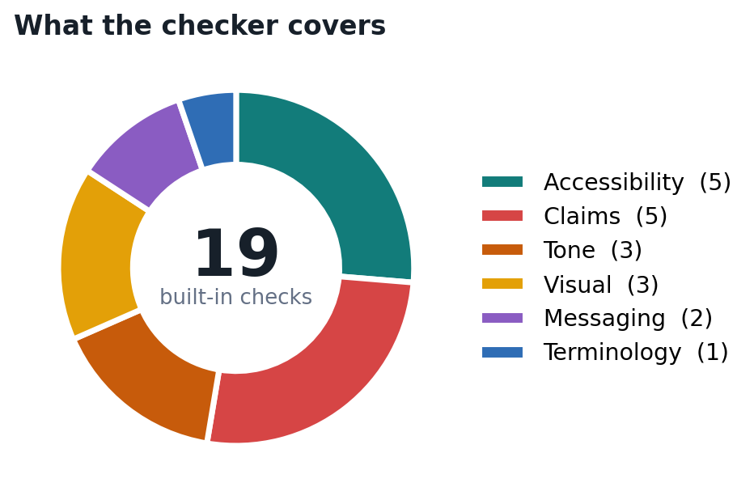</td>
<td width="50%">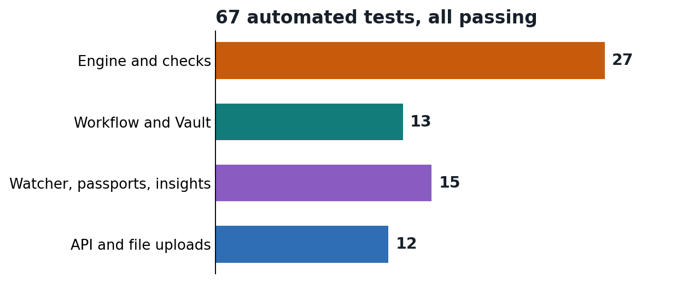</td>
</tr>
</table>

| 🐍 Python | 🟨 JavaScript | 🧪 Tests | 🔌 API endpoints | 📚 Docs |
|:---:|:---:|:---:|:---:|:---:|
| ~3,000 lines | ~1,000 lines | 67 passing | 50+ | 6 guides |

---

## 🏗 Architecture

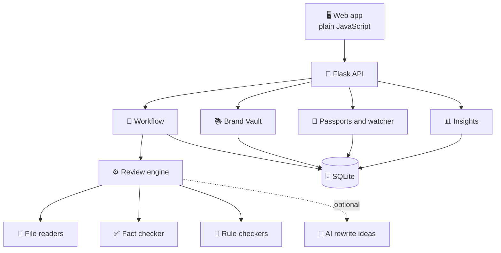

<div align="center">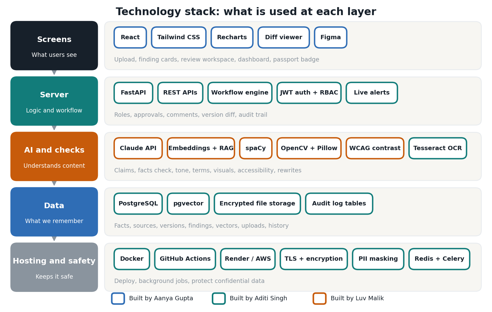</div>

<details>
<summary><b>🗂 Project layout</b></summary>

```text
claimpassport/
├── api.py            HTTP routes (Flask), kept thin
├── workflow.py       drafts, versions, decisions, review, publish, comments, diff
├── vault.py          facts, rules, guideline importer, glossary, assets
├── passports.py      claim passports, Truth Debt, half-life, Truth Feed, proof, timeline
├── watcher.py        source-change and expiry watcher, suggested fixes
├── insights.py       dashboard numbers, repeated mistakes, guideline gaps, trend
├── ingest.py         file readers (txt, md, html, pdf, docx, pptx, images + OCR)
├── security.py       passwords, tokens, roles, personal-data masking
├── audit.py          audit trail and AI transparency log
├── db.py, seed.py    SQLite layer and demo data
└── engine/
    ├── claims.py     find sentences that make claims
    ├── verify.py     match claims to approved facts
    ├── checkers.py   tone, terms, accessibility, visual, messaging
    ├── suggest.py    small, meaning-preserving fixes
    ├── pipeline.py   reasons, sources, confidence, locks
    └── llm.py        optional AI rewrite ideas (off by default)
frontend/             single-page app (ES modules, no build step)
├── index.html, styles.css
└── js/               util, charts, art, app shell, pages/
data/sample/          demo guidelines, facts, glossary, sample files
docs/                 guides, screenshots, diagrams
tests/                unit, API and optional browser tests
scripts/              sample file generator, demo helper
```
</details>

### 📥 What happens to one file

<div align="center">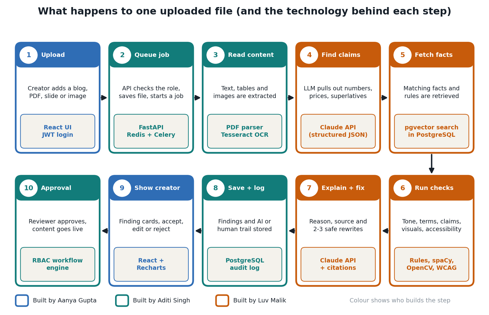</div>

---

## 🔒 Privacy and AI

- **Checks run inside your server.** Nothing is sent anywhere by default.
- The AI helper is **off** unless `ANTHROPIC_API_KEY` is set. It only suggests extra rewrites, never decides.
- Before any AI call, personal data is **masked** and **confidential facts are withheld**.
- Every AI or outside-service call is written to the **AI Transparency log**.

<div align="center">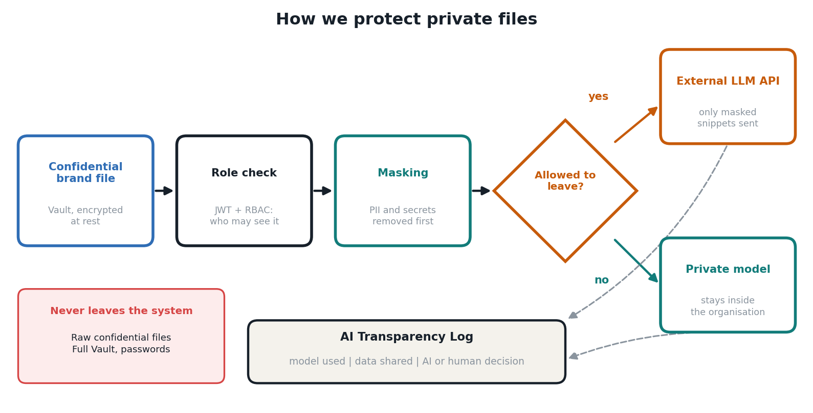</div>

More: **[docs/PRIVACY_AND_AI.md](docs/PRIVACY_AND_AI.md)**.

---

## 🔌 API in 30 seconds

```bash
# 1. sign in
TOKEN=$(curl -s localhost:5000/api/login -H 'Content-Type: application/json' \
  -d '{"email":"priya@demo.cp","password":"demo1234"}' | python -c "import sys,json;print(json.load(sys.stdin)['token'])")

# 2. check some text
curl -s localhost:5000/api/contents -H "Authorization: Bearer $TOKEN" -H 'Content-Type: application/json' \
  -d '{"title":"API test","text":"Plans start at Rs. 599 per month!!"}'

# 3. the public Truth Feed (no login)
curl -s localhost:5000/.well-known/claims.json
```

Full list of endpoints: **[docs/API.md](docs/API.md)**.

<details>
<summary><b>⚙️ Configuration (environment variables)</b></summary>

| Variable | Default | Purpose |
|---|---|---|
| `CP_SECRET_KEY` | dev value | Signs login tokens. **Change it.** |
| `CP_SEED_DEMO` | `1` | Load demo brand, users and content on first start |
| `CP_ADMIN_EMAIL`, `CP_ADMIN_PASSWORD` | `admin@example.com`, `change-me-now` | First admin when demo data is off |
| `CP_DB_PATH`, `CP_UPLOAD_DIR` | `data/...` | Where the database and uploaded files live |
| `CP_EXPIRY_WARN_DAYS` | `14` | When a passport turns "expiring soon" |
| `CP_MAX_UPLOAD_MB` | `10` | Upload size limit |
| `ANTHROPIC_API_KEY`, `CP_USE_LLM`, `CP_LLM_MODEL` | empty | Optional AI rewrite ideas |

See [.env.example](.env.example).
</details>

---

## ⚠️ Honest limits

> [!WARNING]
> This is a **working prototype**. Please read this before relying on it.

- 🗄 **Database:** SQLite by default. The SQL is standard, so PostgreSQL is a planned, not finished, move.
- 🔍 **Search:** fact matching uses a small TF-IDF search. It is explainable but can miss unusual wording. Unsure results are marked low confidence and sent to a person.
- 🤖 **AI helper:** written and unit-tested with a fake client, but **not run against the live API** in the build environment. Test it with your own key.
- 🎨 **Visual checks:** colours, fonts and contrast in HTML; size, shape, colours, alt text and OCR for images. No logo detection or Word/PowerPoint styling checks yet.
- 📎 **Files:** fixes apply to the extracted text of PDF, Word, PowerPoint and image files, not to the original file. Scanned PDFs are not OCR'd yet.
- 🔐 **Security:** passwords are hashed and logins use signed tokens, but there is no encryption of data at rest inside the app and no email or Slack alerts. Change the demo passwords and secret key.
- 🧪 **Not run here:** the Docker build and the GitHub Actions file. The UI was tested in headless Chromium only.

---

## 🗺 Roadmap

- [x] Brand Vault, rule engine, claim checker, 19 checks
- [x] Review workflow with roles, versions, diff, comments, audit trail
- [x] Claim Passports, source-change watcher, Truth Debt, half-life
- [x] Truth Feed, Proof Time Machine, insights, AI Transparency log
- [x] Interactive UI with charts, dark mode and command palette
- [ ] PostgreSQL and migrations
- [ ] Embedding search instead of TF-IDF
- [ ] FastAPI port (only `api.py` needs to change)
- [ ] Email and Slack alerts, scheduled expiry scan
- [ ] OCR for scanned PDFs, write fixes back into Word and PowerPoint
- [ ] Logo and layout checks for images
- [ ] Browser extension to check AI-written content before posting

Details and suggested next tasks: **[docs/ROADMAP.md](docs/ROADMAP.md)**.

---

## 📖 Documentation

| Guide | What is inside |
|---|---|
| 🏗 [ARCHITECTURE](docs/ARCHITECTURE.md) | How one review works, data model, design decisions |
| 🔌 [API](docs/API.md) | Every endpoint with roles |
| 📝 [GUIDELINE_FORMAT](docs/GUIDELINE_FORMAT.md) | Write guidelines the platform can read |
| 🎬 [DEMO_SCRIPT](docs/DEMO_SCRIPT.md) | A 6-minute demo, step by step |
| 🔒 [PRIVACY_AND_AI](docs/PRIVACY_AND_AI.md) | What is sent where, and what is not |
| 🗺 [ROADMAP](docs/ROADMAP.md) | Next tasks and a quality checklist |

---

## 👩‍💻 Team Synqora

| | Name | Focus |
|---|---|---|
| 🧠 | **Luv Malik** (team leader) | AI and detection: claim finding, fact checking, fixes, confidence |
| 🧱 | **Aditi Singh** | Platform and security: database, workflow, watcher, transparency log |
| 🎨 | **Aanya Gupta** | Frontend, insights and demo: screens, dashboard, presentation |

Built for the **Inkloom AI** problem statement. 
## 📄 License

MIT. See [LICENSE](LICENSE).

<div align="center"><sub>Made with ❤️ by Team Synqora · Keep every claim true.</sub></div>
