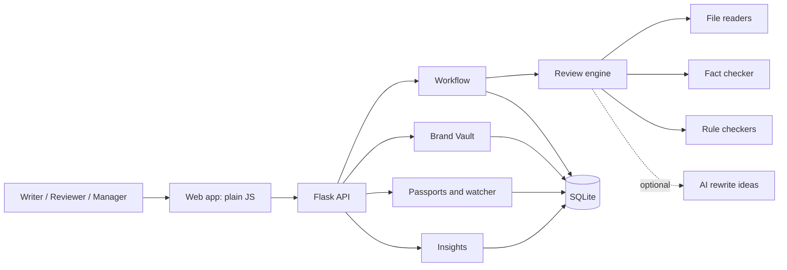

# Architecture

## Big picture

Rule of thumb: **routes are thin, modules own the logic, the engine never changes content.**

## One review, step by step

1. **Ingest** (`ingest.py`): a file or pasted text becomes plain text plus metadata (pages, slide images, image size and colours, OCR text).
2. **Find claims** (`engine/claims.py`): sentences with numbers (money, percent, counts), superlatives ("best"), absolutes ("100%", "24x7"), certificates ("ISO 27001") or comparisons ("cheaper than X"). Dates, versions, times and standards are ignored so they are not mistaken for claims.
3. **Check against facts** (`engine/verify.py`): a TF-IDF search finds the most relevant approved facts. Numbers are compared by value and kind (money vs percent vs count). "Over 5,000" is accepted when the fact says "10,000+". A mismatch is only reported when the fact is clearly about the same thing (score threshold), otherwise the number is "no approved source".
4. **Rule checks** (`engine/checkers.py`): glossary terms, slang and inclusive-language lists, exclamation marks, ALL CAPS, sentence length, alt text, link text, colour contrast (WCAG), brand colours, brand fonts, image size/shape/colour, "Terms apply" on prices, legal promises.
5. **Explain** (`engine/pipeline.py`): each result gets severity, a plain reason, its source (guideline rule or fact with document and page), a confidence level, and flags `human_lock` / `needs_human`.
6. **Suggest** (`engine/suggest.py`): small replacements that change only the problem phrase, or notes when only a person can fix it.
7. **Optional AI** (`engine/llm.py`): if a key is set, up to three important findings get extra rewrite ideas. The AI sees one sentence, the issue and the approved statement (personal data masked, confidential facts withheld). It never decides anything and every call is logged.
8. **Human decides** (`workflow.py`): accept a suggestion, write your own, or keep the wording with a reason. Locked or high-risk findings can only be kept by reviewers, managers or admins.
9. **Apply and re-check:** accepted changes become a new version, which is analysed again. Earlier decisions carry over to findings that did not change.
10. **Review and publish:** submit, approve (another person, never the owner), publish (manager or admin). Publishing freezes a snapshot and creates claim passports.

## Human control rules (all enforced in code and tested)

| Rule | Where |
|---|---|
| Nothing is applied until a person accepts it | `workflow.apply_decisions` |
| Rejecting a finding needs a written reason | `workflow.decide` |
| Creators cannot keep a locked or high-risk claim as written | `workflow.decide` |
| You cannot approve your own content | `workflow.approve` |
| Approval is blocked while findings that need a person are open | `workflow.approve` |
| Locked claims (price, legal, certificate, comparison) need a reviewer, not just a manager | `workflow.approve` |
| Only manager or admin can publish | `workflow.publish` |
| Editing is not possible while content is in review | `workflow.add_version` |
| Source changes only create suggestions, never edits | `watcher.on_fact_changed` |

## Data model (SQLite)

| Table | Purpose |
|---|---|
| `users` | people, role (creator, reviewer, manager, admin), team |
| `facts`, `fact_versions` | approved facts with source, owner, expiry, confidential flag, version history |
| `rules`, `guideline_docs` | structured rules (from guidelines or built in) and the original guideline files |
| `glossary`, `assets` | approved/banned terms; palette, fonts, image rules |
| `contents`, `content_versions` | content, status, every version with its analysis |
| `findings` | each issue: span, rule, reason, source, confidence, suggestions, decision and who decided |
| `comments`, `approvals` | collaboration and review decisions |
| `publications`, `passports` | frozen snapshot per publish, and one passport per verified claim |
| `refresh_proposals`, `notifications` | suggested fixes after a source change, and alerts |
| `audit_log`, `ai_log` | who did what; which AI or external service saw which data |

## Passport status (computed live)

| Status | Meaning |
|---|---|
| valid | source unchanged and not near expiry |
| expiring | source expires within 14 days (`CP_EXPIRY_WARN_DAYS`) |
| source_changed | the fact's wording or value changed after publishing |
| expired | the source's expiry date has passed |
| source_removed | the fact was deactivated |
| override | a person approved the claim without a verified source |

**Truth Debt** = (source_changed + expired + source_removed + override) / all live claims.

## Design decisions

- **Rules first, AI optional.** Deterministic checks are explainable and testable. AI can only add suggestions.
- **Offsets always refer to the original text** (HTML tags are blanked with spaces, not removed), so highlights and replacements stay exact.
- **Version only changes when meaning changes.** Re-verifying a fact (new dates) does not make published pages "stale"; changing the statement or value does.
- **Core logic is framework-free.** Only `api.py` knows Flask, so a move to FastAPI means rewriting one file.
- **Plain JavaScript front end.** No build step, so contributors can start immediately. All dynamic text goes through an escaping template helper (`h`) to prevent XSS, and the server sends a strict Content-Security-Policy.

## Extending

- New check: add a function in `engine/checkers.py`, add it to `ALL`, add a rule row in `vault.BUILTIN_RULES`, add a test.
- New file type: add a `_read_xxx` function in `ingest.py` and the extension in `EXT`.
- New guideline rules without code: use the markdown format in [GUIDELINE_FORMAT.md](GUIDELINE_FORMAT.md).
